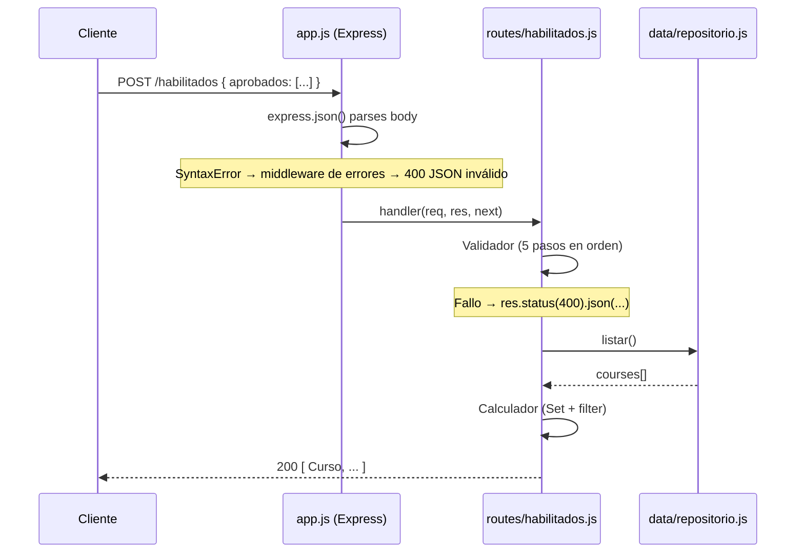

# Design Document

## Overview

The `POST /habilitados` endpoint lets a student submit the list of courses they have already passed and receive back every course in the catalog they are now eligible to enroll in. A course is eligible (habilitado) when every one of its prerequisites appears in the submitted list and the course itself has not already been passed.

The implementation adds one new route file (`src/routes/habilitados.js`) and two small edits to existing files (`src/app.js` to mount the route and adjust the error middleware; `jest.config.js` to enforce the coverage gate). No new npm dependencies are introduced.

## Architecture



The route handler is the only new code path. The repository is read-only and unchanged.

## Components and Interfaces

### `src/routes/habilitados.js` (nuevo)

Responsibilities:
- Register a single `router.post('/', handler)` that is mounted at `/habilitados` from `app.js`.
- Run the Validador in sequence before calling the Calculador.
- Return `res.status(400).json({ error: '...' })` for each validation failure (see exact messages in the HTTP contract section).
- Call `repositorio.listar()` and filter results with the Calculador.
- Return `res.json(resultado)` on success (HTTP 200).

The handler does **not** call `next(err)` for validation failures; it replies directly. It calls `next(err)` only for unexpected errors so the global middleware can produce a 500.

### `src/data/repositorio.js` (existente, sin cambios)

Exposes `listar()`, `listarPorCiclo(n)`, and `obtener(codigo)`. Only `listar()` is used by the new route. The route never reads `data/cursos.json` directly.

### `src/app.js` (existente, dos modificaciones)

1. **Mount new route** — add `app.use('/habilitados', require('./routes/habilitados'))` after the existing `/cursos` mount.
2. **Adjust error middleware** — the existing catch-all currently always returns 500. It must be updated to intercept Express's `SyntaxError` (thrown when `express.json()` encounters an invalid body) and reply with HTTP 400, and to intercept `entity.too.large` errors and reply with HTTP 413:

`app.use(express.json({ limit: '10kb' }))` — limita el body a 10 kb; cualquier cuerpo mayor dispara un error `entity.too.large` que el middleware convierte en 413.

```js
// eslint-disable-next-line no-unused-vars
app.use((err, req, res, next) => {
  if (err instanceof SyntaxError && err.status === 400 && 'body' in err) {
    return res.status(400).json({ error: 'JSON inválido' });
  }
  if (err.type === 'entity.too.large') {
    return res.status(413).json({ error: 'el cuerpo excede el tamaño permitido' });
  }
  console.error(err);
  res.status(500).json({ error: 'internal server error' });
});
```

No stack traces, no file paths, no server internals appear in any response body.

### Validador (lógica dentro de `routes/habilitados.js`)

A sequence of five guard clauses executed before any repository call. Each guard returns immediately on failure. See §Validation Order for the exact sequence and rationale.

### Calculador (lógica dentro de `routes/habilitados.js`)

Builds a `Set` from the validated `aprobados` array, then filters `repositorio.listar()` in one pass. See §Calculador Algorithm.

## Data Models

The only data structure is the existing **Curso** object from `data/cursos.json`:

```js
{
  id:            string,   // "1INF30" — matches ^[0-9A-Z]{6}$
  name:          string,   // "Programación 3"
  credits:       number,   // 5.0
  cycle:         number | null, // 5–10, or null for electivos
  type:          string,   // "obligatorio" | "electivo"
  prerequisites: string[]  // IDs of required prior courses
}
```

The endpoint returns complete Curso objects — no projection, no transformation. The `prerequisites` array in the response contains the same ID strings as in the source data (not enriched with names, unlike `GET /cursos/:codigo`).

The request body schema:

```js
{ aprobados: string[] }  // validated array of course ID strings
```

## HTTP Contract for POST /habilitados

**Request**

| Field | Value |
|-------|-------|
| Method | `POST` |
| Path | `/habilitados` |
| Header | `Content-Type: application/json` |
| Body | `{ "aprobados": ["1INF25", "1INF27", "1INF49"] }` |

**Response 200**

Body: a JSON array of Curso objects, each with fields `id`, `name`, `credits`, `cycle`, `type`, and `prerequisites`. Order matches `repositorio.listar()` (insertion order of `data/cursos.json`).

**Responses 400**

| Condition | Exact error message |
|-----------|---------------------|
| Body is not valid JSON | `"JSON inválido"` |
| `aprobados` absent or not an array | `"aprobados debe ser un arreglo"` |
| Array has more than 100 elements | `"aprobados excede el máximo permitido de 100 elementos"` |
| At least one element is not a string | `"cada elemento de aprobados debe ser un string"` |
| At least one element does not match `^[0-9A-Z]{6}$` | `"código inválido en aprobados"` |

All 400 bodies have exactly one field: `error`. No additional fields, no stack traces, no file paths.

**Response 413**

Condition: request body exceeds 10 kb.
Body: `{ "error": "el cuerpo excede el tamaño permitido" }`

**Response 500**

Condition: unhandled error escapes the handler.  
Body: `{ "error": "internal server error" }` — no server internals.

## Validation Order and Rationale

The Validador runs five checks in this exact order:

1. **JSON válido** — Express parses the body automatically. If it throws a `SyntaxError`, the global error middleware intercepts it before the handler is called, so this check is effectively first. Without a parseable body none of the subsequent checks make sense.

2. **`aprobados` present and is an array** — Structural type check before any iteration. Prevents `TypeError` on `.length` or `.every()` in later steps. Covers the cases where the field is absent, a string, a number, a boolean, `null`, or an object.

3. **Array length ≤ 100** — Checked before iterating over elements so that a 10 000-element payload is rejected after one comparison rather than after 10 000 regex evaluations.

4. **Every element is a string** — Checked before the regex so that a non-string element produces the more specific message (`"cada elemento de aprobados debe ser un string"`) rather than failing the format check with a confusing message.

5. **Every element matches `^[0-9A-Z]{6}$`** — The most expensive guard (regex per element); placed last so it only runs on payloads that have already passed all cheaper checks.

## Calculador Algorithm (O(n))

```
aprobadosSet = new Set(aprobados)          // O(n), n = aprobados.length ≤ 100
resultado = []
for each curso in repositorio.listar():    // O(m), m = 87 courses
  if aprobadosSet.has(curso.id): continue  // O(1) lookup — skip already-passed
  if curso.prerequisites.every(p => aprobadosSet.has(p)):
    resultado.push(curso)
return resultado
```

Using a `Set` makes each `has()` lookup O(1) versus O(n) for `Array.prototype.includes`. With the current dataset (m=87, n≤100) the difference is negligible, but the pattern is correct and scales cleanly if the catalog grows. The `.every()` short-circuits on the first unsatisfied prerequisite.

## Edge-Case Decisions

| Case | Decision | Rationale |
|------|----------|-----------|
| `aprobados: []` (empty list) | Returns all courses whose `prerequisites` is `[]` | Semantically correct: a student with no approved courses can enroll in entry-level courses |
| Duplicate IDs in `aprobados` | Silently collapsed by the `Set` | Duplicates do not change the semantics; rejecting them would add friction without benefit |
| Valid-format ID absent from catalog (e.g. `"ZZZZZZ"`) | Treated as a passed course with no catalog entry; does not cause 500 | The client may legitimately send IDs from outside the current cycle range; the server must not crash |
| Lowercase ID (e.g. `"1inf30"`) | Rejected by `^[0-9A-Z]{6}$` → 400 | The catalog uses uppercase; silent normalization would hide client bugs |
| Response ordering | Preserves `repositorio.listar()` order (JSON source order) | No ordering requirement in the spec; preserving source order is predictable and free |
| Electivos with `cycle: null` | Included if eligible | `cycle` plays no role in prerequisite logic |
| Fields returned | Full Curso object (all 6 fields) | No projection requirement; returning the full object avoids information loss |
| `aprobados` size limit | 100 (≥ 87 courses in the catalog) | Any legitimate query fits within 100; the limit blocks abuse without affecting real use |
| Body size limit (defensa capa 1 — hallazgo DoS) | `express.json({ limit: '10kb' })`; body > 10 kb → 413 `"el cuerpo excede el tamaño permitido"` antes de llegar al Validador. Ejemplo: 5000 códigos × ~9 bytes ≈ 45 kb, rechazado aquí. | Bloquea payloads masivos en Express, antes de cualquier parsing de la lógica de negocio. |
| Array size limit (defensa capa 2 — hallazgo DoS) | Si el body es ≤ 10 kb pero `aprobados` supera 100 elementos (ej. 101 IDs cortos) → 400 `"aprobados excede el máximo permitido de 100 elementos"`. | El límite de 100 ≥ 87 cursos de la malla cubre todo caso legítimo; ambas capas juntas eliminan el vector DoS del hallazgo 1. |

## Error Handling

| Scenario | Handler | HTTP status | Body |
|----------|---------|-------------|------|
| Invalid JSON body | Global error middleware (`app.js`) | 400 | `{ "error": "JSON inválido" }` |
| Body exceeds 10 kb | Global error middleware (`app.js`) | 413 | `{ "error": "el cuerpo excede el tamaño permitido" }` |
| `aprobados` missing or not array | Validador in route handler | 400 | `{ "error": "aprobados debe ser un arreglo" }` |
| Array length > 100 | Validador in route handler | 400 | `{ "error": "aprobados excede el máximo permitido de 100 elementos" }` |
| Element not a string | Validador in route handler | 400 | `{ "error": "cada elemento de aprobados debe ser un string" }` |
| Element fails regex | Validador in route handler | 400 | `{ "error": "código inválido en aprobados" }` |
| Unhandled exception | Global error middleware (`app.js`) | 500 | `{ "error": "internal server error" }` |

No error response ever includes a stack trace, file path, or other server-internal detail.

## Testing Strategy

**File:** `tests/habilitados.test.js`  
**Tools:** Jest + supertest against `src/app.js` (no server port opened)

Tests de ejemplo con Jest + supertest. Se usan múltiples casos en un solo test cuando tiene sentido hacerlo con `test.each`.

**Coverage gate:**  
`jest.config.js` incluye `collectCoverage: true` y `coverageThreshold: { global: { lines: 80 } }`, así que `npm test` (local y en CI) sale con código ≠ 0 cuando la cobertura global de líneas es menor a 80 %. El `ci.yml` no necesita el flag `--coverage`. Ver la sección "Gates de CI".

**Key test cases:**

| Test | Type | Asserts |
|------|------|---------|
| `aprobados: []` | Example | Result equals all courses with `prerequisites:[]` |
| `aprobados: ["1INF25","1INF27","1INF49"]` | Example | Length 27; includes 1INF29/30/31/32 |
| `aprobados` is a string | Example | 400, `"aprobados debe ser un arreglo"` |
| `aprobados` is a number | Edge case | 400, same message |
| `aprobados` is a boolean | Edge case | 400, same message |
| `aprobados` absent | Edge case | 400, same message |
| 101 elements | Edge case | 400, `"aprobados excede el máximo permitido de 100 elementos"` |
| Exactly 100 elements | Example | 200 |
| Invalid code `"1INF30<script>"` | Edge case | 400, `"código inválido en aprobados"` |
| Lowercase `"1inf30"` | Edge case | 400, `"código inválido en aprobados"` |
| Short `"ABC"` | Edge case | 400, `"código inválido en aprobados"` |
| Invalid JSON body | Example | 400, `"JSON inválido"` |
| Unknown valid-format ID `"ZZZZZZ"` | Example | 200; result equals empty-prereq courses |
| All unknown valid-format IDs | Example | 200; result equals empty-prereq courses |
| Arreglo de 5000 códigos válidos (ej. `"1INF25"` repetido) | Edge case | 413, `"el cuerpo excede el tamaño permitido"` — el body (~45 kb) supera el límite de 10 kb; Express lo rechaza antes de llegar al Validador |
| Body mayor a 10 kb (string aleatorio) | Edge case | 413, `"el cuerpo excede el tamaño permitido"` |

## Gates de CI (`.github/workflows/ci.yml`)

| Gate | Herramienta | Umbral | Bloquea / avisa | Etapa | Razón |
|------|-------------|--------|-----------------|-------|-------|
| Secretos | gitleaks 8.24.3 (`gitleaks git . --redact`) sobre **todo el historial** (`fetch-depth: 0`) | Cualquier hallazgo (0 secretos permitidos) | **Bloquea**: el job falla y `build` no corre (`needs`) | Primera etapa, en paralelo con SCA, justo después del checkout y antes de instalar dependencias | Política de TI: "ningún secreto en el repositorio". Un secreto filtrado no se puede deshacer, así que se corta lo antes posible. Se escanea todo el historial porque `gitleaks-action` en un push solo revisa los commits nuevos y no habría detectado la clave del commit inicial. Un hallazgo histórico solo se acepta si la clave fue rotada y se registra en `.gitleaksignore` con su razón. |
| SCA | `npm audit --audit-level=high --omit=dev` | Severidad **high o critical** en dependencias de producción | **Bloquea** con high/critical; moderate y low solo **avisan** (se ven en el log, pero el job pasa) | Primera etapa, en paralelo con secretos, después de `npm ci` (necesita el `package-lock.json` resuelto) | Política de TI: "ninguna dependencia con vulnerabilidades altas o críticas". Bloquear también moderate/low frenaría el desarrollo por hallazgos sin parche o de bajo impacto. `--omit=dev` porque jest y supertest no llegan a producción. |
| Cobertura | Jest (`collectCoverage: true`, `coverageThreshold.global.lines: 80`) | Cobertura global de líneas **< 80 %** | **Bloquea**: `npm test` sale con código ≠ 0 | Segunda etapa (`build`), solo si secretos y SCA pasaron | Política de TI: "la cobertura de líneas no baja de 80 %". Corre después de los gates de seguridad porque no tiene sentido probar código que no se puede desplegar. Se mide global (no por archivo) porque así lo define la política. |